# arXiv research-article classification: how many categories, and how well can we predict them?

Classify arXiv papers from their abstracts into an **unknown** number of subject categories, find the
best number of categories, and train a Hugging Face transformer to predict them.

<!-- RESULTS:TLDR -->

## Contents

1. [Overview and objective](#1-overview-and-objective)
2. [Literature review](#2-literature-review)
3. [Dataset and EDA](#3-dataset-and-eda)
4. [Preprocessing](#4-preprocessing)
5. [Discovering the number of categories](#5-discovering-the-number-of-categories)
6. [Models and training](#6-models-and-training)
7. [Evaluation](#7-evaluation)
8. [Model selection and hyperparameter tuning](#8-model-selection-and-hyperparameter-tuning)
9. [Conclusions](#9-conclusions)
10. [Limitations and future work](#10-limitations-and-future-work)
11. [How to reproduce](#11-how-to-reproduce)

---

## 1. Overview and objective

arXiv labels every paper with one primary category from a three-level taxonomy:
**8 groups** (e.g. Physics) → **20 archives** (e.g. `hep-th`, `cs`) → **~150 fine categories**
(e.g. `cs.LG`). The taxonomy was designed by people for a submission system, so it is not obvious that
it is the best set of classes for *predicting a subject from the text*: some categories are
near-duplicates in content, others are broad.

So this project answers two questions:

1. **How many categories do abstracts really support?** We find out from the text, without using the
   labels, and then check the answer against arXiv's own labels.
2. **How well can a fine-tuned BERT model predict them**, compared with a classic TF-IDF baseline,
   and how much does tuning help?

## 2. Literature review

The three papers this implementation is built on:

| # | Paper | What we take from it |
|---|---|---|
| 1 | **Devlin, Chang, Lee & Toutanova (2019). *BERT: Pre-training of Deep Bidirectional Transformers for Language Understanding.* NAACL-HLT.** [arXiv:1810.04805](https://arxiv.org/abs/1810.04805) | The classifier: a pretrained bidirectional Transformer encoder with a softmax layer on the `[CLS]` token, fine-tuned end-to-end. We use the `bert-base-uncased` checkpoint (110M parameters) from Hugging Face. |
| 2 | **Sun, Qiu, Xu & Huang (2019). *How to Fine-Tune BERT for Text Classification?* CCL.** [arXiv:1905.05583](https://arxiv.org/abs/1905.05583) | The fine-tuning recipe: small learning rate (2e-5), warmup with linear decay, 2–4 epochs, and truncation to 256–512 tokens. It is our default configuration and the centre of our search space. |
| 3 | **Cohan, Feldman, Beltagy, Downey & Weld (2020). *SPECTER: Document-level Representation Learning using Citation-informed Transformers.* ACL.** [arXiv:2004.07180](https://arxiv.org/abs/2004.07180) (SPECTER2: Singh et al., 2023, *SciRepEval*, EMNLP, [arXiv:2211.13308](https://arxiv.org/abs/2211.13308)) | Paper embeddings learned from citations, not from arXiv categories. We cluster SPECTER2 embeddings of the abstracts to find the number of categories, so this step does not depend on the labels we later predict. |

**Supporting references.**

- Beltagy, Lo & Cohan (2019), *SciBERT*, [arXiv:1903.10676](https://arxiv.org/abs/1903.10676). This paper shows that scientific text differs enough from general text that domain pretraining helps, which is why we embed with a science-specific encoder.
- Sanh et al. (2019), *DistilBERT*, [arXiv:1910.01108](https://arxiv.org/abs/1910.01108). A 40% smaller BERT, one of our model-selection candidates.
- Clement et al. (2019), *On the Use of ArXiv as a Dataset*, [arXiv:1905.00075](https://arxiv.org/abs/1905.00075). The pipeline behind the Kaggle snapshot, including the category taxonomy.
- Ward (1963), *Hierarchical grouping to optimize an objective function*, JASA. The linkage used to merge categories.
- Rousseeuw (1987), *Silhouettes*, J. Comput. Appl. Math. Davies & Bouldin (1979), IEEE TPAMI. The cluster-validity indices.
- Satopää et al. (2011), *Finding a "Kneedle" in a Haystack*, ICDCS-W. Knee detection on the metric-vs-k curve.
- Lin et al. (2017), *Focal Loss for Dense Object Detection*, ICCV. Focal loss, one of the tuning choices.
- Akiba et al. (2019), *Optuna*, KDD. TPE search with median pruning.

**Why this setup.** Fine-tuned encoders have been the standard strong baseline for topic
classification since BERT. The task asks for a Hugging Face BERT-family model with TensorFlow weights
and an Apache-2.0 licence; `bert-base-uncased`, `bert-base-cased` and `distilbert-base-uncased` all
qualify. The models are trained with PyTorch, because current `transformers` releases (v5) no longer
include the TensorFlow back-end; the checkpoints are the same.

## 3. Dataset and EDA

**Source:** the [Cornell-University/arxiv](https://www.kaggle.com/datasets/Cornell-University/arxiv)
metadata snapshot (one JSON record per paper, 5.6 GB, snapshot of October 2026).
**Fields used:** title, abstract, categories, comments, and the date of the first version. Notebook:
[`01_eda_preprocessing`](notebooks/01_eda_preprocessing.ipynb).

| | |
|---|---|
| Papers | **3,215,335** |
| Label levels | **8** groups · **20** archives · **151** fine categories (primary category, after mapping legacy names and aliases) |
| Cross-listed papers | **48%** list more than one category (mean 1.74) |
| Abstract length | median **145** words, 99th percentile 287 |

**Imbalance.** Physics accounts for 48% of papers, CS for 26% and mathematics for 19%. Economics and
quantitative finance have 0.4% each. At the fine level the distribution is a long tail:
`cs.CV` has 164k papers and `cs.GL` has 124. A classifier trained on the natural distribution would
mostly learn the largest categories, which is why we sample with a cap per category (§4).

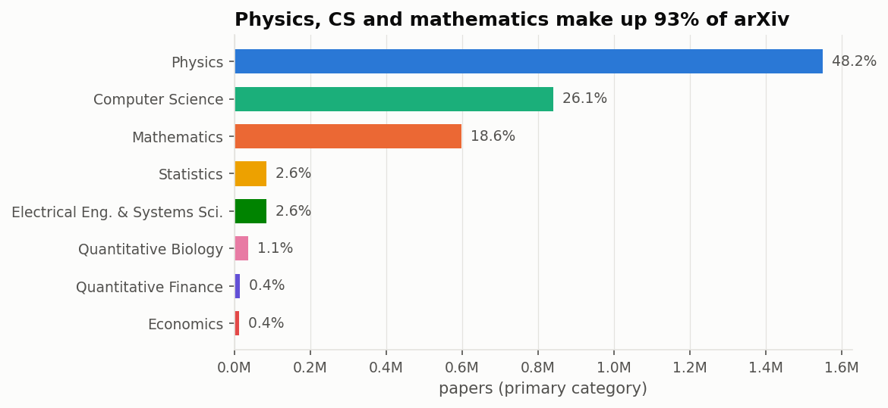
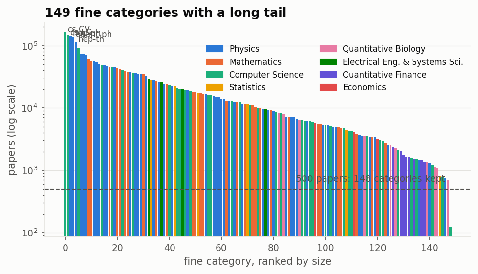

**Cross-listing.** Almost half of all papers carry more than one category, and some fields overlap
heavily. 61% of `eess` papers are also listed in `cs`, 54% of `stat` papers in `cs`, and 47% of `hep-ex`
papers in `hep-ph`. These pairs predict where a classifier will be confused, and they are a first hint
that 150 categories is more than the text can cleanly separate.

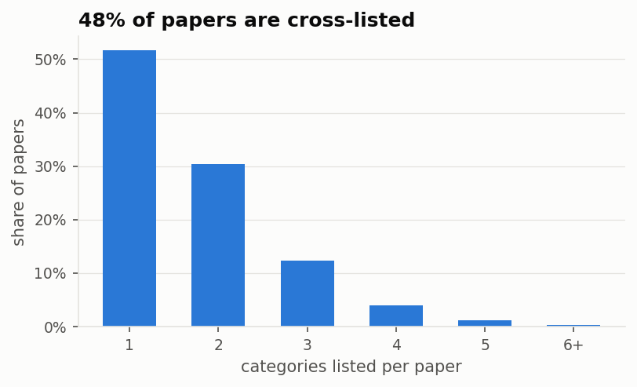
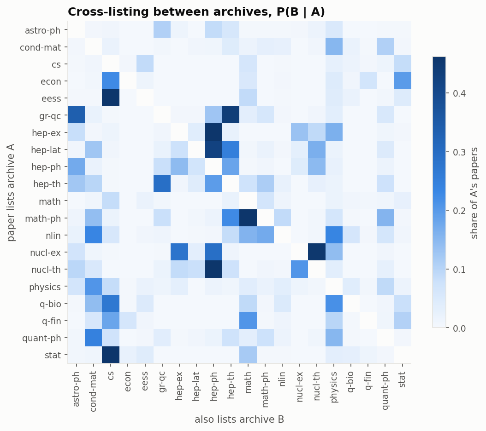

**Length and growth.** Abstracts are short: 99% are under ~290 words, so a 256-token BERT input
covers almost every abstract in full (checked with the tokenizer in §6). Submissions grew from 182k
in 2021 to 284k in 2025, and most of the growth is in computer science.

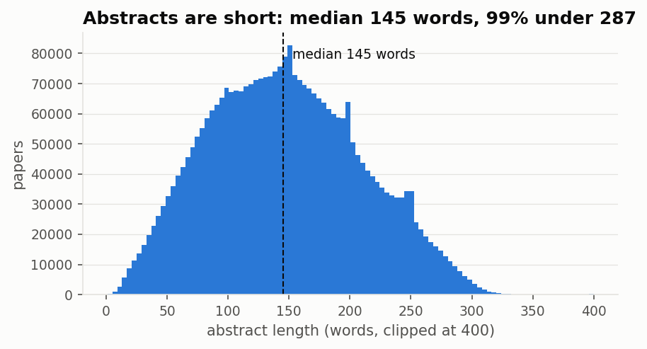
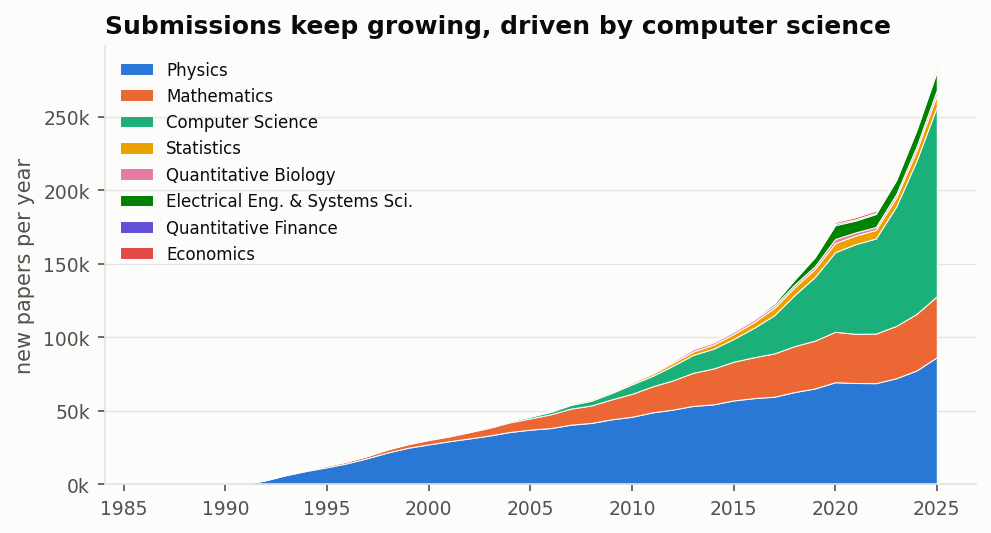

## 4. Preprocessing

| Step | Papers removed |
|---|---:|
| Withdrawn (stated in the abstract or comments) | 7,640 |
| Abstract under 20 words | 14,198 |
| Exact duplicate text (after normalisation) | 540 |
| Primary category is a bare archive name that has sub-categories, e.g. pre-2009 `astro-ph`, which overlaps every `astro-ph.*` class | 105,183 |
| **Kept** | **3,087,774** |

**Text cleaning.** LaTeX math (`$…$`, `$$…$$`, `\[…\]`, equation environments) is replaced with a
`[MATH]` token; `\cite`/`\ref` commands, bracketed citation numbers and URLs are removed; formatting
commands are unwrapped (`\emph{x}` becomes `x`); whitespace is collapsed. The model input is
`title. abstract`.

**Labels.** The primary category is the first one listed, canonicalised: 18 legacy archives such as
`alg-geom` are mapped to their modern equivalents (`math.AG`), and 6 official aliases such as `math.MP`
to their canonical names (`math-ph`). Archive and group are derived from the primary category.

**Sampling and splits.** Fine categories with fewer than 500 papers are dropped; only `cs.GL`
(General Literature) falls below this. Each of the remaining **148** categories contributes 500 randomly
chosen papers, giving **74,000** papers that are balanced at the fine level. They are split 80/10/10,
stratified by fine category, into **59,200 / 7,400 / 7,400** papers for train, validation and test. The
group and archive labels are derived from the same rows, so one split serves every label set. Because
of the cap, the coarser levels are not balanced (Physics has 51 fine categories and Economics 3); the
loss is class-weighted to compensate.

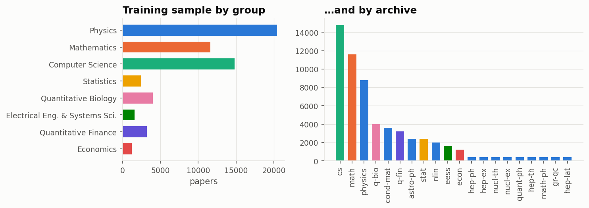

## 5. Discovering the number of categories

Notebook: [`02_discover_k`](notebooks/02_discover_k.ipynb).

### Method

The abstracts of the training split are embedded with two encoders that were **not trained on arXiv
categories**, so the analysis cannot just reproduce the labels:

- **SPECTER2** (`allenai/specter2_base`): a scientific-paper encoder trained on citations. This is the main analysis.
- **MiniLM** (`sentence-transformers/all-MiniLM-L6-v2`): a general-purpose sentence encoder, used as a robustness check.

Then two views are swept over k = 2…80:

1. **Label-free view.** k-means on the (PCA-64) paper embeddings, scored by silhouette and
   Davies-Bouldin. These indices never look at a label.
2. **Taxonomy-guided view.** Each of the 148 fine categories is represented by the mean embedding of
   its papers, and the categories are clustered with Ward linkage. Cutting the dendrogram at k merges
   real arXiv categories into k classes, so each class is still a union of subject categories, as the
   task requires. Each cut is scored by the silhouette and Davies-Bouldin of the papers under the merged
   labels, and by the **macro-F1 of a linear probe** (softmax regression on frozen embeddings, trained on
   the training split and scored on the validation split).

**Decision rule, fixed before seeing the results.** Six criteria each vote for a k in [5, 80]:
k-means silhouette (max), k-means Davies-Bouldin (min), taxonomy silhouette (max), taxonomy
Davies-Bouldin (min), the knee of the probe-F1 curve (Kneedle), and the largest gap between successive
Ward merge heights. The reported k is the **median vote**.

A sanity check on synthetic data with a planted structure (6 topics × 4 near-identical sub-categories)
recovers k = 6 under all six criteria.

### Result: k = 12

| Criterion | SPECTER2 | MiniLM |
|---|---:|---:|
| k-means silhouette, max | 9 | 7 |
| k-means Davies-Bouldin, min | 35 | 50 |
| Taxonomy silhouette, max | 5 | 5 |
| Taxonomy Davies-Bouldin, min | 16 | 26 |
| Probe macro-F1, knee | 28 | 25 |
| Largest Ward merge gap | 9 | 7 |
| **Median → selected k** | **12** | **16** |

The individual votes are spread out because text embeddings have no sharp cluster boundaries
(silhouettes are around 0.13), so several curves are almost flat. The curves themselves are more
informative than any single vote. In the taxonomy-guided view, **separability stays flat between
k ≈ 10 and k ≈ 16**: probe macro-F1 is about 0.78 and silhouette about 0.046 throughout. Below that
range, merging categories buys a lot of separability; above k ≈ 17 both measures fall steadily. Both
encoders put their answer on this plateau. We therefore report **k = 12**, as the rule fixed in
advance selects, with **12–16 as the robust range**.

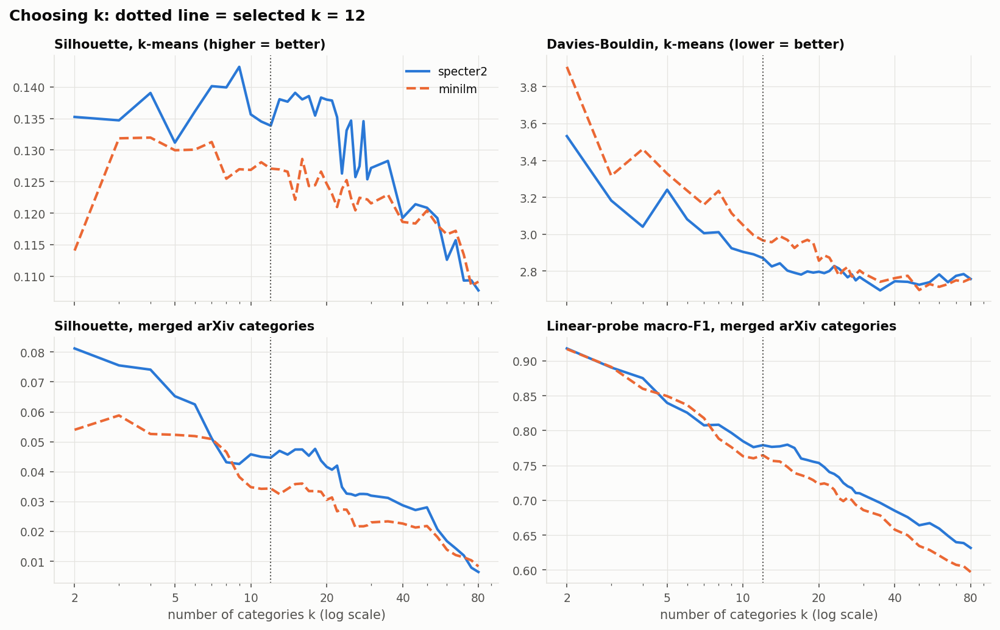

### What the 12 categories are

Names were written by reading each cluster's members (full lists in
[`results/best_k.json`](results/best_k.json)):

| Discovered category | arXiv categories (examples) | # merged |
|---|---|---:|
| Systems, networks & info. theory | cs.DC, cs.NI, cs.IT, cs.AR, eess.SP | 9 |
| ML, vision & signals | cs.LG, cs.CV, stat.ML, cs.RO, eess.IV, q-bio.NC | 14 |
| Quantitative finance | all of q-fin | 7 |
| AI, language, data & software | cs.AI, cs.CL, cs.CR, cs.SE, cs.IR, cs.DB | 9 |
| Statistics, economics & social sci. | stat.ME, stat.TH, econ.*, physics.soc-ph, cs.SI | 15 |
| Algebra, geometry & topology | math.AG, math.NT, math.GT, math.RT, math.DG | 14 |
| Discrete math, logic & theory of CS | math.CO, cs.DS, cs.CC, cs.LO, math.LO | 14 |
| Astrophysics | all of astro-ph | 6 |
| High-energy, nuclear & gravitation | hep-*, nucl-*, gr-qc | 15 |
| Condensed matter, quantum & atomic | cond-mat.*, quant-ph, physics.optics | 12 |
| Analysis, dynamics & math. physics | math.AP, math.PR, math.DS, math-ph, nlin.* | 16 |
| Computational science, biology & fluids | q-bio.*, physics.flu-dyn, math.NA, cond-mat.soft | 17 |

The categories follow **research topic rather than arXiv's administrative boundaries**. Combinatorics
(`math.CO`) groups with algorithms (`cs.DS`); statistics groups with econometrics; numerical analysis
groups with computational physics and biology. This is why agreement with arXiv's own hierarchy is only
moderate: cutting the dendrogram at 8 and at 20 clusters gives an ARI of 0.27 against arXiv's 8 groups
and against its 20 archives. The unsupervised k-means clusters tell the same story. Their agreement
(NMI) with arXiv groups peaks at k = 5 and with archives at k = 18, but it stays modest (≈ 0.42–0.45).
The text supports a topic structure of about a dozen classes, not arXiv's exact boxes.

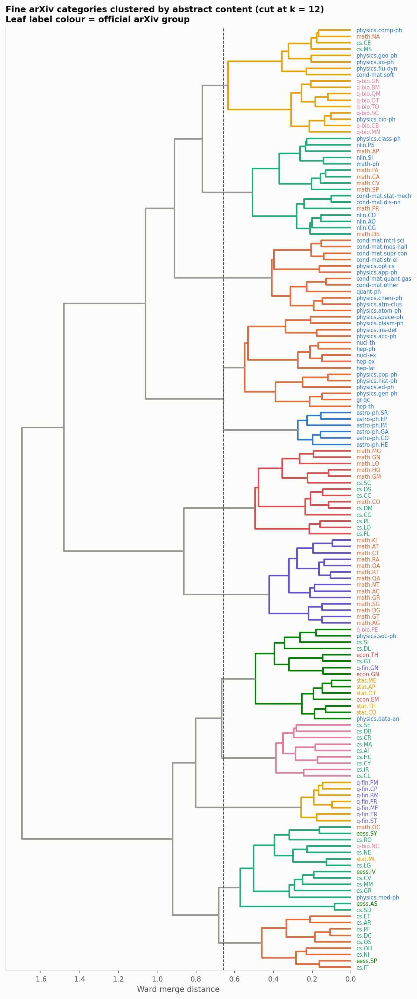
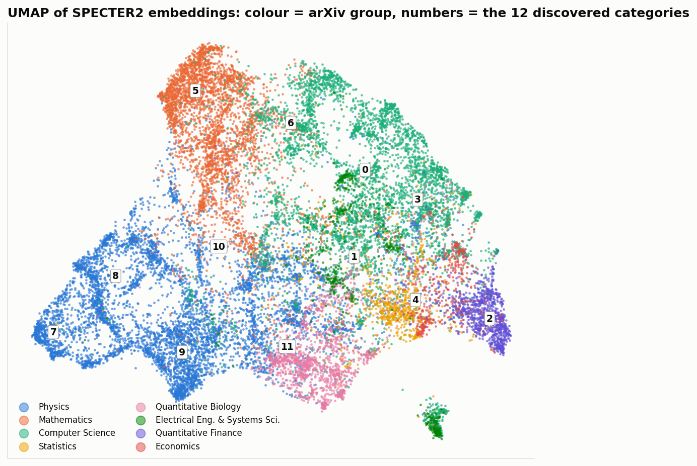
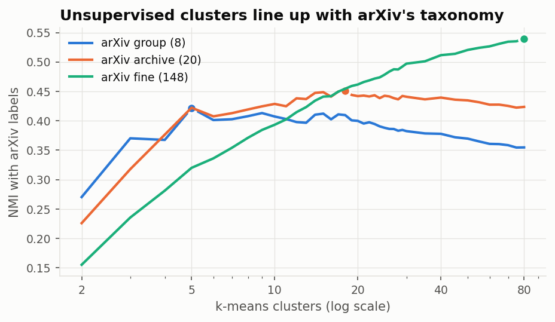

## 6. Models and training

Every model is trained on the same 59,200-paper training split and scored on the same 7,400-paper
validation split. Each is trained four times, once per label set: arXiv's **8 groups**, its
**20 archives**, the **12 discovered categories** from §5, and the **148 fine categories**. Training
at all four granularities shows how predictability changes with the number of classes, which is the
second half of the "best number of categories" question.

**Baseline: TF-IDF + logistic regression.** Word uni- and bigrams (200k features, sublinear TF),
multinomial logistic regression with C = 4 and balanced class weights. It trains in 1–8 minutes on CPU.

**Transformer: `bert-base-uncased`** ([Devlin et al., 2019](#2-literature-review)), fine-tuned
end-to-end with a linear classification head on the `[CLS]` token. It is an Apache-2.0 English
checkpoint from the Hugging Face filter in the task. The model is loaded through the PyTorch classes
of 🤗 Transformers: version 5 of the library (the one installed on Kaggle) has dropped TensorFlow
support, and the checkpoint's weights are identical in both frameworks. The default configuration
follows Sun et al. (2019):

| Setting | Value | Why |
|---|---|---|
| Input | `title. abstract`, truncated to 256 tokens | 68% of inputs fit entirely; the rest lose the end of the abstract (figure below) |
| Optimiser | AdamW, lr 2e-5, weight decay 0.01, 10% linear warm-up | Sun et al.'s recommended range |
| Batch, epochs | 32, 3 | |
| Loss | cross-entropy weighted by inverse class frequency | the group and archive label sets are imbalanced, because sampling was balanced at the fine level |
| Model selection | best epoch on validation macro-F1, early stopping with patience 1 | |
| Hardware | Kaggle T4 ×2, fp16 | **≈ 82 min per run** |

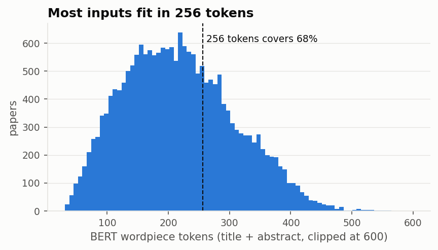

## 7. Evaluation

**Metric.** The headline metric is **macro-F1**: the F1 score of each class, averaged with equal
weight, so small classes count as much as large ones. Accuracy (= micro-F1 for single-label
classification), weighted-F1 and top-3 accuracy are also reported. All numbers below are on the
**validation** split; the test split is used only once, in §8.

| Label set | # classes | TF-IDF macro-F1 | BERT macro-F1 | TF-IDF accuracy | BERT accuracy | BERT top-3 acc. |
|---|---:|---:|---:|---:|---:|---:|
| arXiv groups | 8 | 0.779 | **0.789** | **0.852** | 0.851 | 0.986 |
| **Discovered (§5)** | **12** | 0.795 | **0.801** | 0.789 | **0.795** | 0.965 |
| arXiv archives | 20 | **0.704** | 0.669 | **0.784** | 0.756 | 0.956 |
| arXiv fine categories | 148 | **0.570** | 0.506 | **0.575** | 0.525 | 0.766 |

Full table: [`results/model_results.csv`](results/model_results.csv).

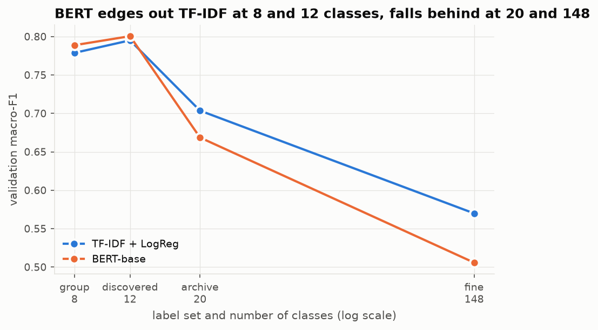

**What the table shows:**

1. **The 12 discovered categories are the most predictable label set.** They score the highest
   macro-F1 for both models, higher even than arXiv's 8 groups, despite having 50% more classes.
   This is independent evidence for §5's choice of k. The categories were picked from unlabelled
   embeddings, and here a separately trained classifier finds them easier to tell apart than coarser
   human-made boxes. Topic-based classes are simply cleaner than administrative ones: arXiv's
   "Computer Science" and "Electrical Engineering" overlap heavily in content (15% of EESS papers
   are predicted as CS; see the confusion matrix below).
2. **Beyond about 12 classes, accuracy falls quickly.** Going from 12 to 20 classes costs about
   10 macro-F1 points, and 148 classes cost 30. Many fine categories are near-duplicates in content,
   and cross-listing (48% of papers, §3) means the "primary" category is often a judgement call.
3. **BERT with default settings is only on par with TF-IDF.** BERT is marginally ahead at 8 and 12
   classes, but behind at 20 and 148. Its validation F1 was **still rising at epoch 3 on every label
   set** (for example 0.39 → 0.48 → 0.51 on fine categories), so the default 3 epochs at lr 2e-5 is
   too little training for many-class problems. This is exactly what §8's tuning addresses. Strong
   TF-IDF baselines are well documented for topic classification, where specific technical vocabulary
   (e.g. "Hamiltonian", "convolutional", "volatility") carries most of the signal.

**Per-class results on the 12 discovered categories (BERT).** The most distinctive fields are the
easiest: Astrophysics (F1 0.89), Algebra/geometry/topology (0.87), Quantitative finance (0.87) and
High-energy physics (0.86). The hardest are the broad, interdisciplinary ones: Analysis, dynamics &
mathematical physics (0.72), AI/language/data/software (0.73) and ML/vision/signals (0.74). The
largest confusion is between the last two (9% of AI papers are predicted as ML), which is expected
for neighbouring areas of computer science.

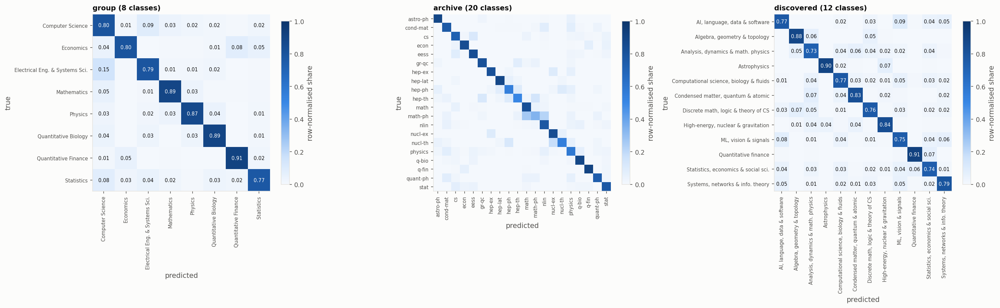

**Most confused fine categories** ([`results/most_confused_fine.csv`](results/most_confused_fine.csv)).
The top errors at the 148-class level are pairs that are hard to separate even for a human reader:
`cs.SD` ↔ `eess.AS` (sound vs audio and speech processing, confused in both directions),
`q-fin.MF` → `q-fin.PR` (mathematical finance vs pricing), `eess.SP` → `cs.IT` (signal processing vs
information theory), `cs.DM` → `math.CO` (discrete mathematics vs combinatorics), and
`math.AT` → `math.KT` (algebraic topology vs K-theory). These are the near-duplicates that §5's
clustering merged into one category.


<!-- RESULTS:TUNING -->

<!-- RESULTS:CONCLUSIONS -->

## 11. How to reproduce

All heavy computation runs on **Kaggle** (free CPU/GPU); the local machine only edits code.

```
├── notebooks/        01_eda_preprocessing · 02_discover_k · 03_train_evaluate · 04_tuning
│                     (.py = source in jupytext "percent" format, .ipynb = executed copy with outputs)
├── src/              preprocess · taxonomy · discover_k · train · evaluate · tune · viz · utils
├── reports/figures/  every figure in this README
├── results/          metrics tables (CSV/JSON) behind every number in this README
└── kaggle/run.py     runs a notebook on Kaggle and downloads its outputs
```

**On Kaggle, by hand.** Create a notebook, attach the dataset `Cornell-University/arxiv`, upload
`src/` as a dataset, paste in a notebook from `notebooks/`, and run. Notebooks 02–04 need
*Accelerator: GPU T4 ×2* and *Internet: on* (to download models from the Hugging Face Hub). Each
notebook reads the previous notebooks' outputs, so attach those as inputs.

**From this repo, automated.** Requires a Kaggle account with a verified phone number (needed for
GPU and internet) and an API token in `~/.kaggle/access_token`:

```bash
pip install kaggle jupytext
python kaggle/run.py push 01          && python kaggle/run.py pull 01   # CPU, ~15 min
python kaggle/run.py push 02 --gpu    && python kaggle/run.py pull 02   # ~30 min
python kaggle/run.py push 03 --gpu    && python kaggle/run.py pull 03   # ~6 h
python kaggle/run.py push 04 --gpu    && python kaggle/run.py pull 04   # ≤ 6 h (self-limiting budget)
```

`push` uploads `src/` and the notebooks as a private Kaggle dataset and starts a private Kaggle
notebook. `pull` waits for it to finish, then copies the figures, results tables and the executed
notebook back into the repo. Seeds are fixed (42) throughout. Library versions are pinned in
`requirements.txt` to match the Kaggle image the results were produced with.
